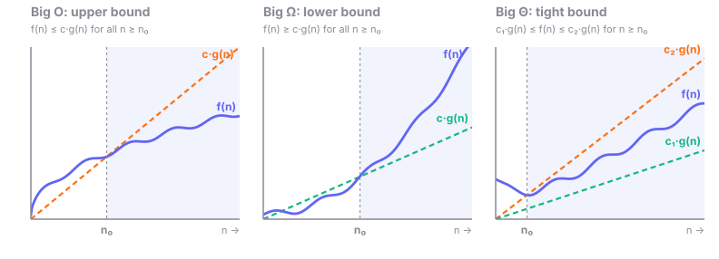
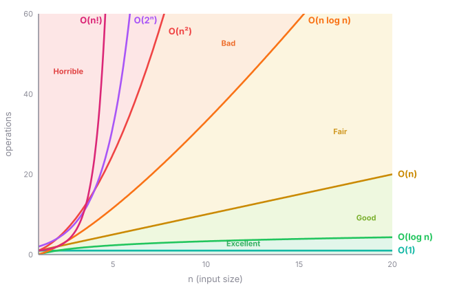

# 00 · Complexity Analysis

> **Goal:** be able to state the time and space complexity of any solution right away, and use the constraints to work out which complexity is expected.

## Core concepts

- **Big-O** gives an upper bound on growth. Drop constants and lower-order terms: `O(3n² + n)` becomes `O(n²)`.
- **Time complexity** counts the dominant operations as the input size grows.
- **Space complexity** counts the extra memory used, *including the recursion stack*.
- **Amortized complexity** is the average cost over a sequence of operations. Appending to a dynamic array is amortized `O(1)` even though an occasional resize costs `O(n)`.
- **Best, average and worst case.** Quicksort is `O(n log n)` on average and `O(n²)` in the worst case. Hash maps are `O(1)` on average and `O(n)` in the worst case.

## Asymptotic notations: O, Ω, Θ, o, ω

All five notations compare how fast a function `f(n)` (your algorithm's cost) grows against a simpler function `g(n)` (such as `n` or `n²`) **as n gets large**. They ignore constants and small inputs.

### The intuition

| Notation | Name | Meaning | Analogy |
|----------|------|---------|---------|
| **O(g)** | Big O | **Upper bound**: grows *no faster* than g | "Your parcel will arrive within your lifetime." It's true, but it only promises a ceiling. |
| **Ω(g)** | Big Omega | **Lower bound**: grows *at least as fast* as g | "I'll pay you *at least* one dollar." It only promises a floor. |
| **Θ(g)** | Big Theta | **Tight bound**: both O and Ω, so it grows *exactly like* g | "Today's high is 25 °C and the low is 19 °C." Both ends are pinned down. |
| **o(g)** | Little o | **Strict upper bound**: grows *strictly slower* than g | A ceiling it never reaches |
| **ω(g)** | Little omega | **Strict lower bound**: grows *strictly faster* than g | A floor it leaves far behind |

Think of them as comparison operators on growth rates:

| | O | Ω | Θ | o | ω |
|---|---|---|---|---|---|
| Like | `≤` | `≥` | `=` | `<` | `>` |

This explains why Θ means O plus Ω: if `x ≤ y` and `x ≥ y`, then `x = y`.

### The graph



- **n₀** is the point after which the bound has to hold. Before n₀ (small inputs), anything goes. That's why constant factors and start-up costs don't matter.
- **c** is a constant multiplier you're allowed to choose. So `3n + 100` is still O(n): pick c = 4, and once n ≥ 100, `3n + 100 ≤ 4n`.
- **Θ** sandwiches f(n) between two multiples of the same g(n) once n is past n₀.

### Formal definitions

| | f(n) is … if … |
|---|---|
| **O(g(n))** | there exist c > 0 and n₀ such that `f(n) ≤ c·g(n)` for all n ≥ n₀ |
| **Ω(g(n))** | there exist c > 0 and n₀ such that `f(n) ≥ c·g(n)` for all n ≥ n₀ |
| **Θ(g(n))** | f(n) is both O(g(n)) and Ω(g(n)): `c₁·g(n) ≤ f(n) ≤ c₂·g(n)` for all n ≥ n₀ |
| **o(g(n))** | for **every** c > 0 there is an n₀ such that `f(n) < c·g(n)` for all n ≥ n₀. Equivalently, `f(n)/g(n) → 0`. |
| **ω(g(n))** | for **every** c > 0 there is an n₀ such that `f(n) > c·g(n)` for all n ≥ n₀. Equivalently, `f(n)/g(n) → ∞`. |

**Big O versus little o:** with Big O you only need *one* constant c to work. Little o has to work for *every* constant c, however small, which is only possible if f grows strictly slower.

| Statement | True? | Why |
|-----------|-------|-----|
| `2n = O(n)` | ✅ | It grows like n, and the 2 doesn't matter |
| `2n = Θ(n)` | ✅ | Bounded above and below by multiples of n |
| `2n = o(n)` | ❌ | 2n/n → 2, not 0. It grows at the same rate, not slower. |
| `2n = O(n²)` | ✅ | It's a valid upper bound, just a loose one |
| `2n = o(n²)` | ✅ | 2n/n² → 0, so it grows strictly slower |
| `n² = Ω(n)` | ✅ | n² grows at least as fast as n |
| `n² = ω(n)` | ✅ | n²/n → ∞ |
| `log n = o(n)`, `n = o(n log n)`, `n² = o(2ⁿ)` | ✅ | Each class in the chart below is little-o of the next |

### Example: when does Θ exist?

```java
void printNums(int[] nums) {           // always touches every element
    for (int x : nums)
        System.out.println(x);
}
// Θ(n): every input of size n costs exactly ~n, so the upper and lower bounds match.

boolean containsZero(int[] nums) {     // may stop early
    for (int x : nums)
        if (x == 0) return true;
    return false;
}
// Best case:  0 is first,    1 step  → Ω(1)
// Worst case: no 0 at all,   n steps → O(n)
// No single Θ covers *all* inputs, because the cost depends on the input.
// But each case on its own has a Θ: best case Θ(1), worst case Θ(n).
```

### ⚠️ Common confusion: "Big O = worst case"

They're **different things**:
- **Best, average and worst case** say *which inputs* you're analysing.
- **O, Ω and Θ** say *how tightly* you're bounding the cost for those inputs.

You can combine them freely. For example, quicksort's worst case is Θ(n²) and its average case is Θ(n log n).

**In interviews**, people say "O" but mean the **tightest** bound, which is really Θ. Saying binary search is O(n²) is technically true, but it's a useless answer. Always give the tightest bound you can, and say which case it's for if it matters ("O(1) on average, O(n) in the worst case").

## Common complexities (fastest to slowest)



| Complexity | Typical source |
|------------|----------------|
| O(1) | Hash lookup, array index |
| O(log n) | Binary search, operations on a balanced tree or heap |
| O(n) | Single pass over the input |
| O(n log n) | Sorting, n heap operations |
| O(n²) | Nested loops, 2D DP over n×n |
| O(2ⁿ) | Subsets, naive recursion |
| O(n!) | Permutations |

## Constraint → target complexity (very useful)

A computer does roughly 10⁸ simple operations per second. Use n to work out which approach is expected:

| n up to | Target | Likely approach |
|---------|--------|-----------------|
| ≤ 10–12 | O(n!) | Permutations, brute force |
| ≤ 20–25 | O(2ⁿ) | Subsets, bitmask, backtracking |
| ≤ 500 | O(n³) | Interval DP, Floyd–Warshall |
| ≤ 5,000 | O(n²) | 2D DP, nested loops |
| ≤ 10⁵ – 10⁶ | O(n log n) / O(n) | Sort, heap, binary search, two pointers, hashing |
| ≥ 10⁹ | O(log n) / O(1) | Binary search on the answer, math |

## Recursion complexity

- **Time** = (number of calls) × (work per call). For a recursion tree, multiply the branching factor raised to the depth by the work done at each node.
- **Space** = maximum recursion depth plus any extra structures.

### Why branching factor b and depth d give O(bᵈ)

Each call makes **b** more calls, so the number of calls multiplies by b at every level:

```
level 0:                 f(n)                          1 call   = b⁰
                    /     |     \
level 1:         f()     f()    f()                    b calls  = b¹
                / | \   / | \   / | \
level 2:       ...  each makes b more ...              b² calls
  ⋮
level d:                                               bᵈ calls
```

**Total calls** = b⁰ + b¹ + b² + … + bᵈ. That's a geometric series:

```
1 + b + b² + … + bᵈ  =  (bᵈ⁺¹ − 1) / (b − 1)
```

For b ≥ 2, this is **less than 2·bᵈ**. The last level alone is bigger than all the levels above it combined (for b = 2: 1 + 2 + 4 = 7 < 8). Drop the constant and you get **O(bᵈ) calls**.

Multiply by the work per call: **Time = O(bᵈ × work per call)**.

| b (branches) | d (depth) | Calls | Example |
|--------------|-----------|-------|---------|
| 1 | n | 1 + 1 + … + 1 = n + 1 → **O(n)** | Linear recursion: factorial, linked-list recursion |
| 2 | n | ~2ⁿ⁺¹ → **O(2ⁿ)** | Naive Fibonacci, subsets (include or skip) |
| 3 | n | ~3ⁿ → **O(3ⁿ)** | Three choices per step |
| 4 | L | ~4ᴸ → **O(4ᴸ)** | Word Search: 4 directions per letter (really 3 after the first, since you can't go back) |
| n, n−1, n−2, … | n | n! → **O(n!)** | Permutations: the branching shrinks by one each level |

Notes:
- **This is an upper bound (O), not always tight (Θ).** In Fibonacci the two branches have different depths (n−1 and n−2), so the tree is lopsided. The true count is about 1.618ⁿ. O(2ⁿ) is still correct and is the expected answer in interviews.
- **Memoization collapses the tree.** With a memo array or `HashMap`, Fibonacci only has n *distinct* states, each computed once. That's O(n) time instead of O(2ⁿ). That's DP in a nutshell: **time = number of distinct states × work per state**.
- **Space is the depth d, not bᵈ**, because only one root-to-leaf path is on the call stack at any time.

### Handy sums

| Sum | Formula | Big-O | Shows up as |
|-----|---------|-------|-------------|
| 1 + 2 + … + n | n(n+1)/2 | O(n²) | Nested loops with `j < i`; checking every pair |
| 1 + x + x² + … + xⁿ (x > 1) | (xⁿ⁺¹ − 1)/(x − 1) | O(xⁿ) | Recursion trees: dominated by the last level |
| 1 + 2 + 4 + … + 2ⁿ | 2ⁿ⁺¹ − 1 | O(2ⁿ) | Nodes in a perfect binary tree; dynamic array resizing |
| n + n/2 + n/4 + … | < 2n | O(n) | Quickselect, building a heap: dominated by the first term |
| 1 + 1/2 + 1/3 + … + 1/n | ≈ ln n | O(log n) | Harmonic series: looping over the multiples of every i (n/1 + n/2 + … + n/n) costs O(n log n) |

### Master theorem (divide and conquer)

For recursions that split into **a** calls on pieces of size **n/b**, with **O(nᵈ)** work outside the calls: `T(n) = aT(n/b) + O(n^d)`

- if `d > log_b a`, the answer is `O(n^d)`: the top level dominates
- if `d = log_b a`, the answer is `O(n^d log n)`: every level does equal work. Merge sort is `2T(n/2)+O(n)`, which gives `O(n log n)`.
- if `d < log_b a`, the answer is `O(n^(log_b a))`: the leaves dominate

These are the same three cases as the geometric series above: growing, flat, or shrinking work per level.

## Built-in operation costs (Java)

| Operation | Cost |
|-----------|------|
| `ArrayList.add(x)`, `list.remove(list.size() - 1)` | O(1) amortized |
| `list.add(0, x)`, `list.remove(0)`, `list.contains(x)` | O(n). Use `ArrayDeque` for both ends, or a `HashSet` for lookups. |
| `ArrayDeque` `offer`/`poll`/`push`/`pop`/`peek` at either end | O(1) |
| `HashMap` / `HashSet` `get`, `put`, `containsKey`, `contains` | O(1) average |
| `TreeMap` / `TreeSet` `get`, `put`, `floorKey`, `ceilingKey` | O(log n) |
| `Arrays.sort` / `Collections.sort` | O(n log n) |
| `PriorityQueue` `offer` / `poll` | O(log n). `peek` is O(1), `remove(obj)` is O(n). |
| `new PriorityQueue<>(collection)` | O(n) |
| `s += t` on a `String` in a loop | O(n²) overall. Use a `StringBuilder`. |
| `substring`, `Arrays.copyOfRange`, `toCharArray`, `clone()` | O(length): they copy |

## Pitfalls

- Forgetting to count recursion stack space.
- Calling `list.contains(x)` inside a loop, which silently makes it O(n²).
- Treating `substring` or array copying as O(1).
- Using sorting when O(n) is expected.

## Practice

There are no specific problems for this topic. State the complexity of every problem you solve in the other topics.

## My Notes

-
